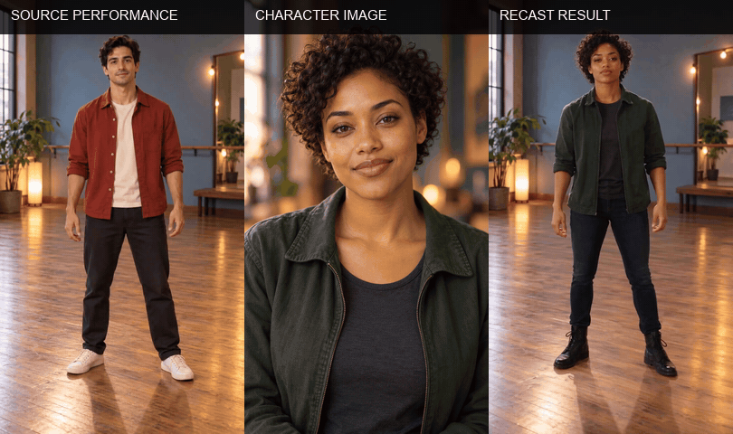

# Open Genjutsu

**Recast the performer in a short video with a character reference.** Keep the original movement and location, review the result, and export a local MP4 with the source soundtrack restored.

Open Genjutsu is a local-first workspace: source media is previewed and retained on your device, while the generation request runs through a configured video API.

  

## Sample avatar animation

<p align="center">
  <a href="docs/media/avatar-sample.mp4"></a>
  <br />
  <sub>Fictional character animation · 5 sec · 720p · Start frame: <a href="docs/media/avatar-sample.png">PNG</a> · Full clip: <a href="docs/media/avatar-sample.mp4">MP4</a></sub>
</p>

This is an example character clip. The app's recast flow takes a source performance video and a character image as its two inputs.

## Subject replacement sample

<p align="center">
  <a href="docs/media/recast-sample.mp4"></a>
  <br />
  <sub>Source clip: <a href="docs/media/source-performer.mp4">MP4</a> · Source start frame: <a href="docs/media/source-performer.png">PNG</a> · Character reference: <a href="docs/media/avatar-sample.png">PNG</a> · Recast result: <a href="docs/media/recast-sample.mp4">MP4</a></sub>
</p>

The source performer and character are fictional generated examples. The result keeps the studio setting and the source clip's simple hand gesture while replacing the performer.

## How it works

1. **Choose the inputs.** Add a 4–30 second source clip and a character reference image.
2. **Review before submitting.** Preview the full source clip and character image. Add an optional short direction.
3. **Submit one recast request.** The motion-control workflow derives motion and scene guidance from the source clip internally; the app does not submit separate depth-map or background-removal jobs.
4. **Check the result.** The app polls the request, downloads the generated video, and muxes the source soundtrack locally when one is present.
5. **Save the MP4.** Review the full result and download it from the local app.

The motion-control endpoint is a single generation request. It does not use the separate draft/finalize calls available on some other video endpoints.

## Requirements

- Python 3.10+
- FFmpeg and `ffprobe` on your `PATH`
- An API key and available generation credits

Install FFmpeg with your system's package manager, then confirm both executables are available from a new terminal.

<details>
<summary>Install FFmpeg</summary>

```bash
# macOS with Homebrew
brew install ffmpeg

# Debian or Ubuntu
sudo apt install ffmpeg
```
</details>

## Run locally

```bash
git clone https://github.com/Anil-matcha/open-genjutsu.git
cd open-genjutsu
python3 -m venv .venv
source .venv/bin/activate
pip install -r requirements.txt
python -m uvicorn app:app --host 127.0.0.1 --port 8770
```

On Windows PowerShell, activate with `.venv\Scripts\Activate.ps1`.

Open <http://127.0.0.1:8770>, enter your API key, choose the source clip and character image, and upload them. The key stays in page memory and is forwarded by the local app with each request.

## Media limits

| Input | Supported formats | Limit |
| --- | --- | --- |
| Source video | MP4, MOV | 4–30 seconds; 50 MB |
| Character reference | JPEG, PNG, WebP | 10 MB |

The source must be readable by FFmpeg. Use one character image per recast. The app checks the source duration before upload.

## Privacy and local files

- The API key is held in page memory and is not written to disk or application logs.
- The source video is uploaded for recasting and kept locally under `runtime/assets/` for previews and soundtrack restoration.
- The character image is uploaded for the recast request and previewed in the browser.
- Generated exports are written under `runtime/exports/`.
- Use **Clear local files** when finished, or remove `runtime/` after stopping the server.
- The server binds to `127.0.0.1`. Keep it there; this app has no authentication for public hosting.
- Uploaded media is subject to the generation API's storage and retention terms.

Keep the server process and browser tab open while a job runs. Request state is held in memory and does not survive a server restart.

Use only source footage and likeness references you have permission to process and share. Review the result before publishing it.

## API adapter

The local FastAPI adapter uses these requests:

| Purpose | Request |
| --- | --- |
| Upload source and reference | `POST /api/v1/upload_file` |
| Submit the recast | `POST /api/v1/seedance-2.5-motion-control` with `video_url`, `images_list`, optional `prompt`, `aspect_ratio`, `duration`, and `generate_audio: false` |
| Check generation status | `GET /api/v1/predictions/{request_id}/result` |

The model request uses the original source video and character image directly. Its motion-control pipeline prepares depth and scene references internally.

The local app restores source audio after generation with FFmpeg. Replace the adapter calls in `app.py` to connect a different service with the same submit-and-poll pattern.

## Troubleshooting

| Issue | What to check |
| --- | --- |
| FFmpeg is not ready | Install FFmpeg, open a new terminal, and confirm `ffmpeg -version` and `ffprobe -version` work. |
| Upload is rejected | Check format, size, duration, API key, and account balance. |
| A request times out | Resume status checks or inspect request history before submitting again. |
| Source audio is missing | Confirm the source file still exists under `runtime/assets/` and FFmpeg can read its audio codec. |
| Job state is missing | The app process may have restarted. Start a new session and upload the media again. |

## Project layout

```text
app.py              Local FastAPI server and API adapter
static/index.html   Workflow interface
static/app.js       Upload, polling, review, and export flow
static/styles.css   Responsive studio interface
runtime/assets/     Temporary local source copies (ignored by Git)
runtime/exports/    Local exports (ignored by Git)
```

## License

Open Genjutsu is licensed under the MIT License. See [LICENSE](LICENSE).
